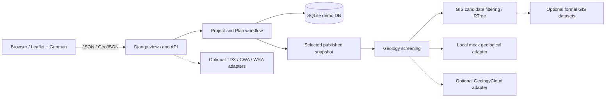
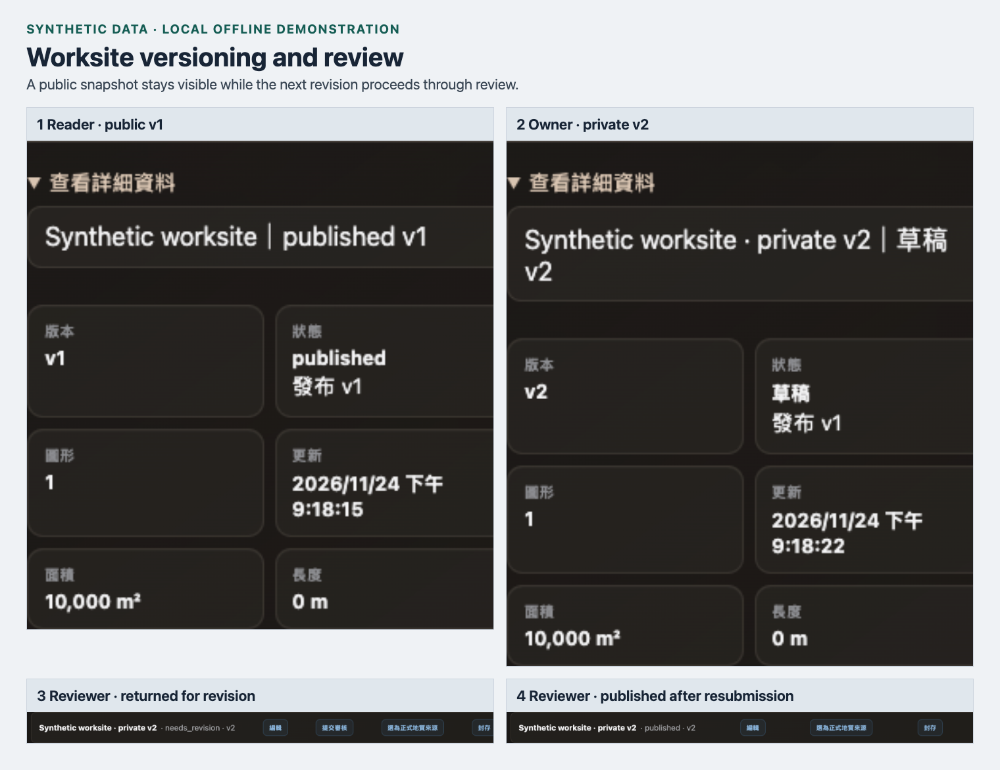
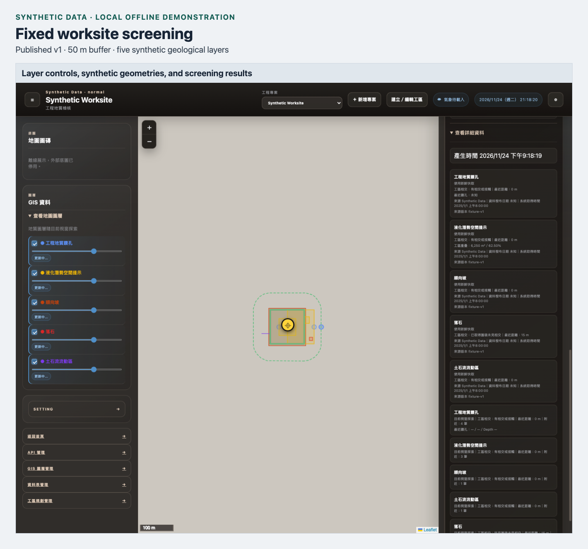
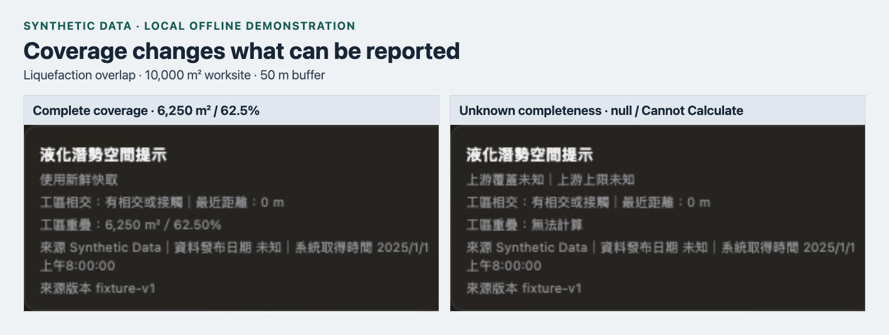

# Worksite GIS — Engineering Geology Screening

**Worksite Geospatial Information and Engineering Geology Screening**

A personal WebGIS project demonstrating worksite versioning, geospatial analysis and reproducible engineering geology screening. Screening uses the exact worksite revision a reviewer published. A reproducible synthetic case demonstrates how to query geological features, measure their spatial relationships and report gaps in the evidence.

**繁體中文摘要**　Worksite GIS 將工區繪製、私人修訂、審核發布與工程地質初步檢核串成同一流程。系統以指定的發布工區作為固定分析基準，使用合成圖層驗證相交、最近距離與液化聯集面積。案例可離線重現，適用範圍為合成資料與本機隔離環境。

[Run the local demo](docs/demo-runtime.md) · [Reproduce the case study](docs/cases/synthetic-geological-screening/README.md) · [Review validation evidence](docs/validation-summary.md)

## Engineering motivation

Worksite boundaries change during design. If a draft edit or a map pan changes the geometry behind a screening result, an engineer loses the reference needed to reproduce it. Worksite GIS keeps the published revision, analysis parameters and source provenance together. The system records the difference between the service returning data and the available evidence supporting a coverage estimate.

## Key features

- Draw worksite polygons in Leaflet and export permitted snapshots as GeoJSON.
- Keep private revisions and review decisions separate from the published worksite visible to readers.
- Explore the current viewport or screen a selected, fixed worksite against five geological layers.
- Query spatial candidates with SQLite RTree and refine them with exact geometry predicates.
- Run a loopback-only demonstration with synthetic data, local map libraries and generated local accounts.

## Architecture



Solid paths describe components exercised in the Code-Only synthetic validation. Dashed paths indicate optional integrations or formal data whose production operation is **NOT VERIFIED**. The spatial index also has a separate synthetic benchmark. [Architecture and boundaries](docs/architecture.md)

## Worksite workflow

An owner creates and submits a worksite draft. A reviewer can return it with a reason or publish it. After publication, an authorized owner can start a private revision while a general reader continues to see the previous published snapshot. The project’s selected worksite determines the screening geometry. Publishing a new revision advances that snapshot, and archiving the selected worksite stops screening until a replacement is explicitly selected.



## Geological screening

GeoJSON uses EPSG:4326 longitude–latitude coordinates. The synthetic case projects the worksite to EPSG:3826, the TWD97 TM2 121° zone, for metric computations. A buffer creates a search vicinity around the fixed published polygon. The analysis tests intersection with the polygon and computes shortest distance to its boundary or interior. Liquefaction coverage is the area of the union of the polygon’s intersections with valid liquefaction features, divided by the polygon area.

The five layer types are engineering boreholes, liquefaction, dip slopes, rockfall and debris-flow tracks. The display limit constrains features returned for rendering. Candidate scan limits and missing coverage evidence affect analysis completeness and are reported separately.



## Reproducible synthetic case

| Input or result | Reference value |
| --- | --- |
| Worksite | 100 m × 100 m = **10,000 m²** |
| Search buffer | **50 m** |
| Liquefaction union inside worksite | **6,250 m² / 62.5%** |
| Liquefaction result when completeness is unknown | **`null` / Cannot Calculate** |

The case includes synthetic GeoJSON, a machine-readable independent reference and an offline runner. [Case study and reproducibility commands](docs/cases/synthetic-geological-screening/README.md)



## Local demo

From the repository root on macOS or Linux:

```sh
python3.13 -m venv .venv
. .venv/bin/activate
python -m pip install -r requirements.txt
python demo.py
```

Open `http://127.0.0.1:8000/`. The launcher prints the location of a private `accounts.json` containing credentials generated for this run. The [demo guide](docs/demo-runtime.md) covers Windows PowerShell commands, role walkthroughs, restarting with `--scenario unknown` and SQLite backup. Dependency installation may require a package index. The demonstration uses local assets and mock services.

## Tests and validation

**Historical Phase 4 baseline, 2026-11-24.** macOS 15.8.2 x86_64, Python 3.13.14, Django 5.2.17, SQLite 3.50.4, Node 24.22.1 and Chrome 158.0.8127.36. The Code-Only pytest suite collected **538** tests, with **531 passed, 7 deselected, 0 failed, 0 skipped and 2 warnings**. The 23 offline-case tests are included in the 531. Chrome A–O, isolated SQLite backup and restore, Django checks, migration drift checks and local `DEBUG=False` static delivery passed on that baseline. [Validation scope and exact exclusions](docs/validation-summary.md)

The previous local portfolio milestone collected **540** tests, with **533 passed, 7 deselected, 0 failed, 0 skipped and 2 warnings** on macOS and isolated SQLite. The two additional cases verify portable source arguments for optional import tools. GitHub Actions runtime remains unverified.

The renamed local candidate collected **542** tests on macOS, with **535 passed, 7 deselected, 0 failed, 0 skipped and 2 warnings**. The 23-case offline runner and 16 Chrome scenarios passed. The two added checks verify the new Django namespace on a fresh database and the synthetic project identifier.

## Limitations

The geological features and case measurements use Synthetic Data. They support reproducibility of the screening method. Site-specific geology, coverage, risk and construction safety require separate professional evidence. Formal GIS datasets, live government upstreams, operational PostgreSQL, hosted deployment and end-to-end Linux and Windows operation are **NOT VERIFIED**. The demo is local. Public release remains **BLOCKED** pending rights and release authorization.

## Technology stack

Django 5.2 and Python 3.13 serve the UI and API. Leaflet 1.9.4 and Geoman Free 2.18.0 provide browser mapping and editing. SQLite stores demo records and powers RTree candidate retrieval. Shapely and PyProj handle geometry and projection. Pytest and Node exercise server and browser-side contracts.

## License and attribution

Third-party notices are listed separately from project rights. This local review candidate has no declared project-wide public license. Public distribution remains subject to code and asset rights confirmation. [Third-party notices](THIRD_PARTY_NOTICES.md)
